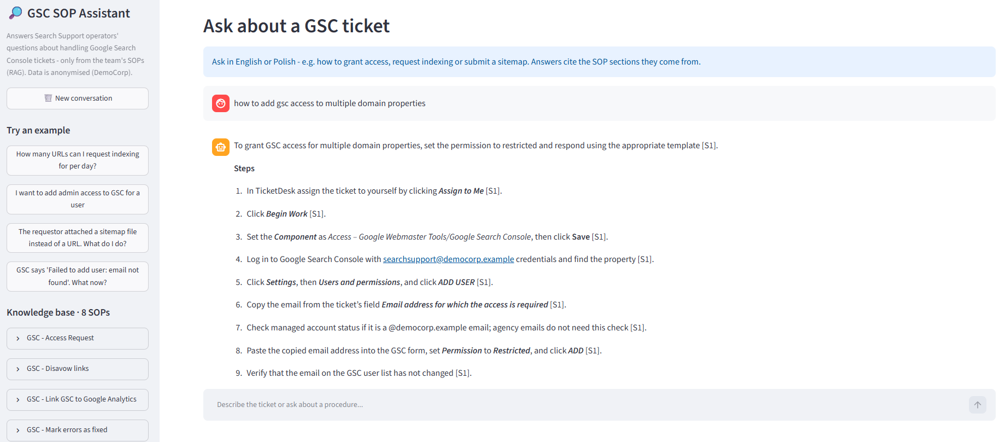
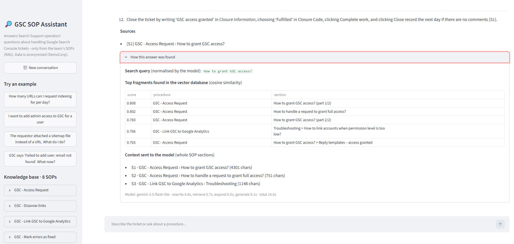
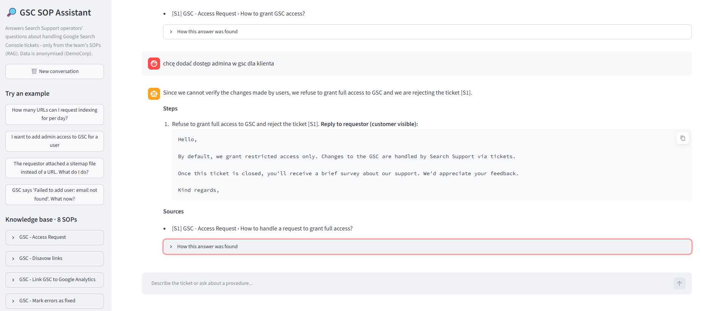
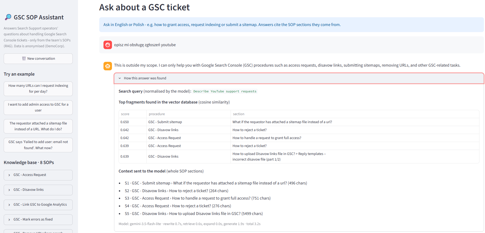

# GSC SOP Assistant (RAG)

A retrieval-augmented assistant for Search Support operators. It answers questions about handling **Google Search Console (GSC) tickets** – which steps to take, which reply to send to the requestor, how to close or reject the ticket – using **only** the team's Standard Operating Procedures (SOPs), and cites the SOP section behind every answer.

> Built as the practical assignment "Zbuduj asystenta AI z RAG" (SensAI Learn – Prompt & Context Engineering).
> The knowledge base is **anonymised**: company, people, systems and domains were replaced with fictional ones (DemoCorp, TicketDesk, `*.example`).

## Why

Search Support operators handle many kinds of GSC tickets, each described in a separate SOP. A new operator has to find the right document and section, follow the steps and copy the exact reply for the requestor. The assistant does this in one question: it retrieves only the SOP fragments that answer it, explains the steps and cites the sections it used.

## Knowledge base

`data/sop/` – 8 SOPs in Markdown (front matter `doc_id` / `title`, sections `##`/`###`, reply templates in `text` blocks):

| SOP | Covers |
|---|---|
| GSC - Access Request | granting restricted access, managed accounts, email-not-found, full-access requests |
| GSC - Disavow links | uploading / replacing a disavow file, rejecting incorrect files |
| GSC - Link GSC to Google Analytics | linking to GA4, removing a link, missing admin permissions |
| GSC - Mark errors as fixed | validating fixes (e.g. Core Web Vitals) |
| GSC - Remove URLs from search results | single URL / whole site removal |
| GSC - Request indexing | daily limit, indexing requests, missing URLs |
| GSC - Submit sitemap | submit, remove, resubmit, file instead of URL |
| GSC - Update or Remove website | removing a property, change of address |

## Architecture

```
INGEST  (python ingest.py)
data/sop/*.md -> split by ## / ### sections (long sections cut between numbered steps, 1-step overlap)
              -> "Procedure / Section" header added to every chunk         -> 32 chunks
              -> Gemini embeddings (gemini-embedding-001, RETRIEVAL_DOCUMENT)
              -> ChromaDB, local, cosine distance, metadata: procedure, section, order

ANSWER  (assistant.py)
question (+ chat history)
  -> query normalisation by the LLM: English, standalone, SOP vocabulary
     (the model gets a catalog of all procedures/sections generated from the DB)
  -> multi-query retrieval: normalised + original question, top-5 chunks
  -> guardrail 1: best similarity < 0.60  -> "not found in the SOPs", no LLM call
  -> small-to-big: each hit expanded to its whole ## section (max 5; sections > 6000 chars
     trimmed to hits + neighbours + reply templates)
  -> context: system prompt + last 6 messages + sources S1..S5 (+ templates tagged T1, T2...)
  -> Gemini 3.5 Flash-Lite (fallback 3.1 Flash-Lite, retries on 429/503)
  -> post-processing in code: {{T1}} replaced by the exact SOP template text,
     source list built from the metadata of the sections cited as [S1]
```

### Design decisions (and the test that led to them)

| Decision | Why |
|---|---|
| Chunk by section, overlap of one step | SOPs have natural sections; a citation points to a specific section |
| Small-to-big expansion | Reply templates sit in a separate `###` chunk – the model claimed "no template in the SOP" when only the steps were retrieved |
| Templates pasted by code (`{{T1}}`) | Guarantees the customer-facing text is copied 1:1 and keeps answers short (faster) |
| Query normalisation + SOP catalog | The same question in Polish returned "not found"; "admin access" did not match the section about "full access" |
| Multi-query retrieval | Normalisation can over-simplify ("add admin access" -> "grant GSC access"); the original wording is searched too |
| Threshold 0.60 + system prompt rules | In-scope questions scored 0.66–0.81, clearly off-topic 0.50–0.58; near-domain questions (Merchant Center, Ads, SEO: 0.61–0.66) overlap, so the prompt handles them |
| Flash-Lite models | Free tier: 3.8 Flash = 20 requests/day and ~17 s per answer; 3.5 Flash-Lite = 500/day and ~2 s |

## Bonuses

- **Source citations** – `[S1]` after every step, exact rules quoted in "double quotes"; the source list under each answer is built by the app, not by the model.
- **Guardrails** – similarity threshold (no LLM call for off-topic), answers only from the sources, out-of-scope refusal, retrieved text treated as data, "new policies" that contradict the SOPs are rejected, the system prompt is never revealed.
- **Multi-turn** – chat history (last 6 messages); follow-up questions are rewritten into standalone search queries.

## Setup (Windows, no admin rights needed)

Requirements: Python 3.10+ and a free Gemini API key from [Google AI Studio](https://aistudio.google.com).

Open **Command Prompt** (cmd, not PowerShell) in this folder:

```bat
python -m venv %USERPROFILE%\venvs\gsc-rag
set PY=%USERPROFILE%\venvs\gsc-rag\Scripts\python.exe
%PY% -m pip install -r requirements.txt
copy .env.example .env
notepad .env
%PY% check_env.py
%PY% ingest.py
```

In Notepad paste your key after `GEMINI_API_KEY=` and save. `ingest.py` builds the local vector database (`chroma_db/`).

> Why a virtual environment in a short path: Python from Microsoft Store installs packages in a very long folder path and Windows (without admin rights to enable long paths) fails on files deeper than 260 characters, e.g. inside `streamlit`.

## Run

```bat
%PY% -m streamlit run app.py
```

Open http://localhost:8501. Under every answer: the cited sources and a **"How this answer was found"** panel (normalised query, top fragments with similarity scores, sections sent to the model, model and timing).

Console version for quick tests: `%PY% chat_cli.py`.

## Screenshots

**Answer with citations** – every step cites the SOP section it comes from; the operator steps and the customer reply are kept apart.



**"How this answer was found"** – the normalised search query, the top fragments with similarity scores, the whole sections sent to the model, the model and the timing of each stage.



**Question in Polish, restricted request** – "admin access" is not allowed by the SOP: the assistant refuses with the SOP's reasoning and inserts the exact rejection template inside the step that sends it.



**Out of scope** – a question about YouTube tickets is refused; nothing is invented from general knowledge.



## Tests

| Script | What it checks | Result |
|---|---|---|
| `eval/test_retrieval.py` | is the right SOP in the top-k for 12 questions; scores of 6 off-topic questions (threshold choice) | Hit@1 11/12, Hit@5 12/12, right section 9/9 |
| `eval/test_answers.py` | 15 end-to-end scenarios: facts the model cannot know, reply templates (complete, inside the right step), Polish vs English, restricted request (admin access), follow-up, out-of-scope, prompt injection | 15/15 |
| `eval/bench_models.py` | latency and template completeness per model | |

Reports are written to `eval/*.md`.

### Adding a new SOP

1. Convert it to Markdown in `data/sop/` (front matter, `##` sections, reply templates in `text` blocks; check that operator steps and customer replies are not mixed).
2. Remove client data.
3. Run `ingest.py` – the procedure catalog and the list of supported procedures update automatically.
4. Add 2–3 questions about the new SOP to `eval/test_retrieval.py` and `eval/test_answers.py` and run both.

## Project structure

```
app.py               Streamlit chat UI
assistant.py         answer pipeline (normalisation, retrieval, guardrails, generation, templates, sources)
rag.py               embeddings, vector search, small-to-big expansion, SOP catalog
ingest.py            chunking + embeddings + ChromaDB
config.py            models, top-k, threshold, limits
prompts/             system prompt and query-normalisation prompt
chat_cli.py          console chat
check_env.py         environment check
eval/                tests and reports
data/sop/            anonymised SOPs (knowledge base)
```

## Data and privacy

- No client data: the SOPs were anonymised before being added to this repository.
- `.env` (API key) and `chroma_db/` are git-ignored.
- Gemini API free tier – in the EEA the paid-service data terms apply to free usage as well.
